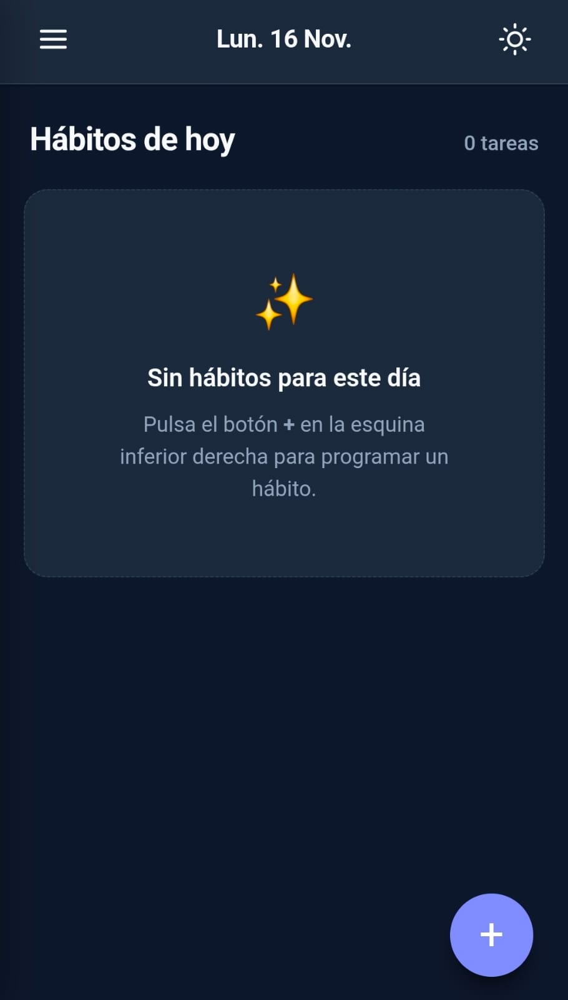
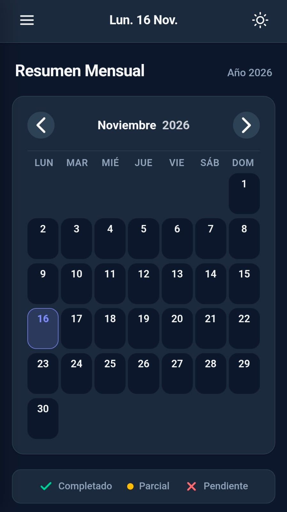

# Tracky

Tracky es una aplicación web progresiva (PWA) diseñada para el seguimiento y control de hábitos diarios. Está construida íntegramente con tecnologías web estándar (HTML5, CSS3 modular y JavaScript Vanilla ES6) bajo una arquitectura de página única (SPA), sin depender de frameworks de interfaz de usuario.

La aplicación sigue un enfoque *offline-first*: todos los datos se almacenan localmente en el navegador mediante IndexedDB y los recursos estáticos se gestionan a través de un Service Worker, lo que permite utilizarla sin conexión a internet tanto en dispositivos móviles como en escritorio.

---

## Vistas de la Aplicación

### Vista por Día | Vista por mes

<p>
  
  &nbsp;&nbsp;&nbsp;
  
</p>

---

## Estructura del Proyecto

```text
tracky/
├── index.html              # Documento principal HTML5, importmap de librerías y contenedores base
├── manifest.json           # Configuración de instalación PWA (nombre, colores, orientación e ícono)
├── sw.js                   # Service Worker para almacenamiento en caché y funcionamiento offline
├── assets/
│   ├── icons/
│   │   └── icon.svg        # Ícono vectorial principal de la aplicación
│   └── images/
│       ├── vista-por-dia.png # Captura de pantalla de la vista diaria
│       └── vista-por-mes.png # Captura de pantalla de la vista mensual
├── css/
│   ├── variables.css       # Definición de variables CSS para los temas claro y oscuro
│   ├── base.css            # Reset de estilos, tipografía base y transiciones globales
│   ├── layout.css          # Disposición de la barra superior fija, contenedor principal y botón FAB
│   ├── components.css      # Estilos de tarjetas de hábitos, círculos de estado, modales y menú lateral
│   └── calendar.css        # Adaptación visual del calendario mensual e indicadores de estado
└── js/
    ├── main.js             # Punto de entrada, estado global de fecha seleccionada y cambio de vistas
    ├── db/
    │   └── db.js           # Conexión a IndexedDB (tracky-db) y operaciones CRUD para tareas y registros
    ├── logic/
    │   ├── dateUtils.js    # Funciones puras para formateo y manejo de fechas en hora local
    │   ├── recurrence.js   # Evaluación de reglas de recurrencia según la fecha de creación
    │   └── dayStatus.js    # Cálculo del estado general de un día a partir de sus hábitos activos
    └── ui/
        ├── header.js       # Renderizado de la cabecera, menú lateral deslizante y botón de retorno
        ├── theme.js        # Control y persistencia del tema visual (claro/oscuro) en localStorage
        ├── taskList.js     # Renderizado de la lista diaria, bloqueo por fecha y autoguardado
        ├── modal.js        # Modal híbrido para creación, edición y confirmación de borrado de hábitos
        ├── calendarView.js # Configuración del calendario mensual y cálculo de estados en memoria
        └── confetti.js     # Animación de recompensa al completar todos los hábitos del día actual
```

---

## Creación, Edición y Eliminación de Hábitos

### Crear un hábito
1. En la vista del día actual o de un día futuro, presionar el botón flotante `+` ubicado en la esquina inferior derecha.
2. Ingresar el nombre del hábito y seleccionar su frecuencia (`Solo este día`, `Diaria`, `Semanal`, `Mensual` o `Anual`). Por defecto se selecciona `Solo este día`.
   - *Nota:* Si el hábito se crea posicionado en un día futuro, su fecha de inicio (`createdAt`) será ese día futuro y la opción `Diaria` permanecerá deshabilitada.
3. Presionar **Guardar** para almacenarlo en IndexedDB y actualizar la lista.

### Editar o eliminar un hábito existente
1. En la lista diaria, hacer clic directamente sobre el **título del hábito** (el texto cambia de color al pasar el cursor para indicar que es interactivo).
2. Se abrirá el modal en modo **Editando hábito** con los datos actuales cargados en el formulario:
   - **Para modificarlo:** Cambiar el nombre o la frecuencia y presionar **Guardar**.
   - **Para eliminarlo:** Presionar el botón rojo con el ícono de papelera situado en la esquina inferior izquierda del modal. Aparecerá un cuadro de confirmación superpuesto (`¿Eliminar hábito?`); al confirmar en **Eliminar**, el registro se borrará de la base de datos y la lista se actualizará de inmediato.

---

## Lógica de Estados y Funcionamiento por Fechas

### 1. Evaluación de Recurrencia (`js/logic/recurrence.js`)
Cada hábito almacena su fecha de creación (`createdAt` en formato `YYYY-MM-DD`) y su regla de repetición. Ningún hábito se muestra en fechas anteriores a su creación. Para fechas iguales o posteriores a `createdAt`:
- `none` (Solo este día): Aparece únicamente en la fecha exacta de su creación.
- `daily` (Diaria): Aparece todos los días a partir de su fecha de creación.
- `weekly` (Semanal): Aparece cada vez que coincide el día de la semana con el de su fecha de creación.
- `monthly` (Mensual): Aparece el mismo número de día de cada mes.
- `yearly` (Anual): Aparece cuando coinciden el día y el mes con su fecha de creación.

### 2. Cálculo del Estado del Día (`js/logic/dayStatus.js`)
Para determinar qué indicador mostrar en cada celda del calendario mensual, la aplicación cruza la lista de hábitos activos de esa fecha con el objeto de progreso guardado en la tienda `dailyLogs` de IndexedDB:
- **Vacío (`empty`):** No existen hábitos programados para esa fecha. La celda del calendario no muestra ningún ícono debajo del número.
- **Completado (`completed`):** Todos los hábitos activos del día tienen estado `true`. Se representa con un check verde. Si esto ocurre en el día actual, se dispara la animación de celebración.
- **Parcial (`partial`):** Al menos un hábito está completado (`true`) y al menos uno sigue pendiente (`false`). Se representa con un punto amarillo.
- **Pendiente / No completado (`uncompleted`):** Hay hábitos programados para ese día, pero ninguno ha sido marcado como completado. Se representa con una cruz roja.

### 3. Reglas de Interacción según la Fecha (`js/ui/taskList.js`)
- **Día actual:** Permite crear hábitos, editarlos y marcar o desmarcar su círculo de estado con autoguardado inmediato.
- **Días pasados:** Modo de solo lectura para el progreso. El botón flotante `+` se oculta y los círculos de estado quedan deshabilitados para preservar el historial real.
- **Días futuros:** Permite usar el botón `+` para dejar programados hábitos a futuro, pero mantiene los círculos de estado deshabilitados hasta que llegue esa fecha.

---

## Dependencias Externas (vía CDN ESM)

- [idb](https://www.npmjs.com/package/idb): Wrapper ligero basado en promesas para IndexedDB.
- [vanilla-calendar-pro](https://www.npmjs.com/package/vanilla-calendar-pro): Componente de calendario mensual sin dependencias.
- [canvas-confetti](https://www.npmjs.com/package/canvas-confetti): Generador de partículas en canvas para la animación de día completado.
